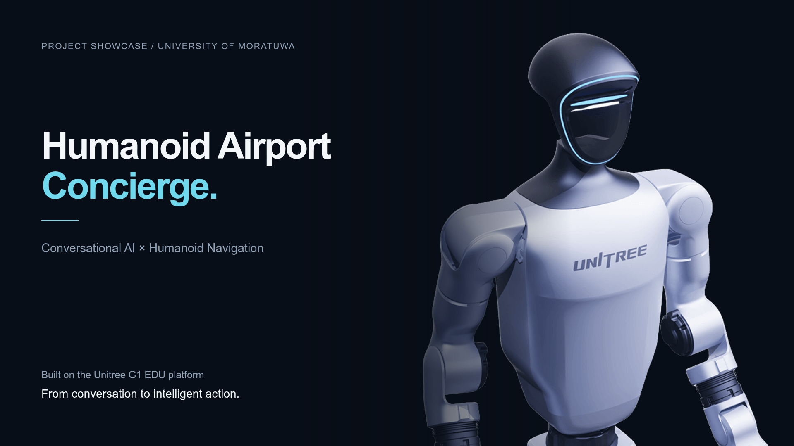
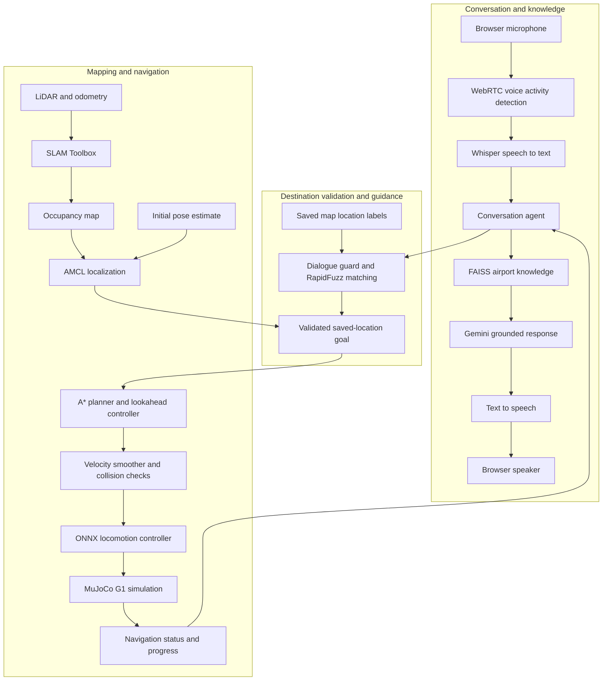

# Humanoid Airport Concierge · Unitree G1 EDU

**From conversation to intelligent action.**

An Embedded Systems Individual Project exploring how a humanoid robot can answer airport passenger questions, understand destination requests, and provide indoor guidance. The system combines a grounded voice assistant, a browser navigation console, LiDAR mapping, and simulated humanoid locomotion.



**University of Moratuwa · Embedded Systems Individual Project**

**ROS 2 Humble · MuJoCo · A* Navigation · Whisper · FAISS · Gemini · RapidFuzz · React**

[System architecture](#system-architecture) · [Getting started](#getting-started) · [Documentation](#documentation) · [Project report](docs/report/g1_paper.pdf)

## Project overview

Airport passengers often need help finding boarding gates, washrooms, baggage areas, and other services. This project investigates a conversational approach to that assistance: ask a question, receive an answer grounded in airport information, and explicitly request guidance to a location on the loaded map.

The showcase presents mapping, a recorded conversation demonstration, navigation in MuJoCo, and the system architecture. Generated walking footage illustrates the concept; the engineering demonstrations use simulation.

## Key capabilities

- **Grounded conversation:** Whisper speech recognition, FAISS knowledge retrieval, Gemini responses, and synthesized speech.
- **Spoken destination requests:** a dialogue guard uses **RapidFuzz** to match explicit guidance requests to saved map locations, with clarification for ambiguous matches.
- **Mapping and localization:** SLAM Toolbox builds occupancy maps; AMCL localizes the robot on a saved map using an explicit initial pose.
- **Indoor navigation:** eight-connected A* planning, lookahead/P-heading control, live obstacle checks, and bounded recovery.
- **Browser console:** manual mapping, saved-map import, location labels, goal selection, and continuous voice interaction.
- **Humanoid simulation:** ONNX locomotion control, a MuJoCo/ROS 2 bridge, and compact greeting, pointing, and guidance gestures.

## Current implementation

The primary workflow runs in **MuJoCo with ROS 2 Humble**. The browser voice pipeline can hand validated saved-location goals to the navigator and report progress from navigation feedback.

Navigation has evolved from an earlier Nav2 planning stack to a **standalone A* planner and controller**. Nav2 components remain in use for the map server, AMCL, velocity smoothing, and Collision Monitor. The existing `NavigateToPose` action interface is retained. Earlier showcase footage and research material may describe the previous Nav2 planning stage.

Physical deployment and evaluation with airport passengers remain future work. Reported simulation checks and offline tests are described in the [guide documentation](g1-ros2-workspace/docs/concierge_guide.md#validation-results).

## System architecture



**Airport knowledge and robot destinations have different sources.** FAISS retrieves information for answers. The selected map's saved labels provide destination IDs, positions, and orientations. Navigation coordinates come from that catalog, with localization, readiness, free-space, and emergency-stop checks before movement.

**RapidFuzz handles destination-name matching.** Names are normalized and common synonyms are resolved before fuzzy comparison against saved labels and aliases. The resolver tolerates small spelling or recognition differences, requires a clear best match, and preserves gate, terminal, and floor numbers. Unknown or ambiguous destinations require clarification.

For detailed implementation and validation limits, see [Browser voice and navigation](g1-ros2-workspace/docs/browser_voice_navigation.md). The separate [robot communication architecture](Robot_Architecture.md) describes onboard computers, cloud services, and Unitree interfaces.

## Example passenger interaction

1. Load a saved map, set the robot's initial pose, and prepare named destinations.
2. Start a conversation. The assistant asks for the passenger's name and destination.
3. Ask **“Where is the office?”** The assistant identifies the saved destination and offers guidance.
4. Say **“Take me to the office”** or **“Take me there”** after a single prior offer to request an escort.
5. The system validates the destination and begins guidance after the spoken invitation starts playing.
6. Navigation feedback drives progress, arrival, or failure narration. **“Stop navigation”** cancels guidance.

Use a location actually saved on the selected map. Ambiguous names trigger clarification; acknowledgements such as “yes” or “thanks” alone do not initiate movement. Multilingual intents use translation and pass through the same destination validation.

## Repository components

| Component | Role |
| --- | --- |
| [`g1_core`](g1-ros2-workspace/src/g1_core) | ONNX locomotion state machine, teleoperation, and shared guide gestures |
| [`g1_mujoco`](g1-ros2-workspace/src/g1_mujoco) | MuJoCo bridge exposing robot state and simulated sensors as ROS 2 topics |
| [`g1_mapping`](g1-ros2-workspace/src/g1_mapping) | Voxelized 3D LiDAR mapping and RViz visualization |
| [`g1_navigation`](g1-ros2-workspace/src/g1_navigation) | SLAM, AMCL, A* navigation, command arbitration, and web gateway |
| [`g1_conversation`](g1-ros2-workspace/src/g1_conversation) | Airport knowledge, speech engines, grounded answers, and RapidFuzz destination matching |
| [`g1-navigation-ui`](g1-navigation-ui) | React/Vite console and browser voice/navigation integration |
| `unitree_mujoco` / `unitree_rl_mjlab` | Simulator/model and RL environment submodules |

## Getting started

### Prerequisites

- Ubuntu with **ROS 2 Humble**; the current console launcher sources `/opt/ros/humble/setup.bash`.
- Python **3.10** and `colcon`, with ROS dependencies installed for the workspace packages.
- A prepared simulation environment at `g1-ros2-workspace/.venv` containing MuJoCo, NumPy, SciPy, ONNX Runtime, and PyYAML.
- Node.js **22**, matching the console's Vite 7 setup.
- A **Google Gemini API key** for grounded responses and embeddings.
- Internet access for Gemini, the default Edge TTS backend, and initial model/dependency downloads.

The voice launcher prepares a separate `.rag-venv` on first use. The simulation model is supplied by the repository's submodules. For environment-specific setup and controls, follow the [console guide](g1-navigation-ui/README.md).

### 1. Clone and build

```bash
git clone --recurse-submodules https://github.com/RafiMAA/Unitree_G1_EDU_Robot.git
cd Unitree_G1_EDU_Robot/g1-ros2-workspace

unset PYTHONPATH
export PYTHONNOUSERSITE=1
source /opt/ros/humble/setup.bash
colcon build --symlink-install --packages-select \
  g1_core g1_mujoco g1_mapping g1_navigation g1_conversation
source install/setup.bash
```

### 2. Start simulation

In a terminal opened in `g1-ros2-workspace`:

```bash
export PYTHONNOUSERSITE=1 ROS_DOMAIN_ID=0 ROS_LOCALHOST_ONLY=1 MUJOCO_GL=glfw
source /opt/ros/humble/setup.bash
source install/setup.bash
export PYTHONPATH="$PWD/.venv/lib/python3.10/site-packages:${PYTHONPATH:-}"
ros2 launch g1_mujoco sim.launch.py \
  start_rosbridge:=false cmd_vel_topic:=/cmd_vel_safe
```

Keep this terminal running. The console manages its own rosbridge connection; simulation runs separately.

### 3. Start the console

In another terminal opened in `g1-navigation-ui`, with Node 22 available:

```bash
npm ci
export G1_CONVERSATION_MODE=pipeline
npm run dev
```

Set `GOOGLE_API_KEY` in the environment before starting the UI, or in the workspace's `.env` as described in the [voice guide](g1-navigation-ui/README.md#continuous-rag-conversation-and-spoken-navigation). Keep API keys out of version control.

Open the address printed by Vite, normally `http://localhost:5173`. `npm run dev` starts the local process manager, rosbridge, and UI; the selected tab starts the required ROS services. Keep a single console instance per ROS domain. Use `npm run ui` when managing ROS services separately.

### 4. Prepare the environment and start a conversation

1. Use **Mapping** to build and save a map, or import an existing YAML/image map pair.
2. Use **Labeling locations** to save destination names and poses for that map.
3. In **Navigate** or **RAG Conversation**, load the saved map and set **2D Pose Estimate** to the robot's actual position and heading.
4. Wait for localization, then open **RAG Conversation**, allow microphone access, and select **Start conversation**.
5. Ask a question or explicitly request guidance to a saved destination.

For mobile browser audio, follow the [HTTPS setup](g1-navigation-ui/README.md#phone-microphone-and-speaker). For standalone 3D mapping and RViz, see the [mapping package guide](g1-ros2-workspace/src/g1_mapping/README.md).

## Validation and limitations

The repository includes dialogue, destination-matching, browser-audio, navigation, and simulation checks. The [conversational guide](g1-ros2-workspace/docs/concierge_guide.md#reproduce-automated-checks) documents how to reproduce them and separates synthetic ROS checks from headless MuJoCo locomotion checks.

- Live speech/model accuracy depends on audio conditions, language, network access, and the supplied knowledge base.
- Routes depend on the saved map, label catalog, and a correct initial pose.
- Navigation assumes planar indoor floors. Terrain, stairs, and footstep planning remain outside the current implementation.
- Manual Mapping mode bypasses collision stopping and slowdown; emergency stop and stale-command handling remain active.
- Physical deployment requires real localization/odometry, calibrated sensor transforms and motion parameters, and supervised hardware testing with an emergency stop.

## Documentation

| Resource | Contents |
| --- | --- |
| [Navigation console](g1-navigation-ui/README.md) | Startup, maps, labels, voice interaction, browser audio, and HTTPS |
| [A* navigation](g1-ros2-workspace/src/g1_navigation/README.md) | Planner, controller, parameters, recovery, and ROS interfaces |
| [3D mapping](g1-ros2-workspace/src/g1_mapping/README.md) | LiDAR voxel mapping and RViz workflow |
| [Conversational airport guide](g1-ros2-workspace/docs/concierge_guide.md) | Dialogue, gestures, narrated escorts, configuration, and checks |
| [Browser voice and navigation](g1-ros2-workspace/docs/browser_voice_navigation.md) | Voice-to-goal handoff and validation scope |
| [Robot communication architecture](Robot_Architecture.md) | Cloud, onboard computers, and Unitree interfaces |
| [Project report](docs/report/g1_paper.pdf) | Research background, system design, and reported experiments |

## Acknowledgments and license

Developed as an **Embedded Systems Individual Project** at the **University of Moratuwa** for airport passenger assistance. Built on Unitree Robotics, ROS 2, MuJoCo, SLAM Toolbox, Nav2 localization/safety components, LangChain, FAISS, Whisper, RapidFuzz, and Google Gemini.

Licenses are defined per package: `g1_conversation` uses MIT; `g1_mapping` and `g1_navigation` use Apache-2.0. See the corresponding `package.xml` files and the upstream submodule licenses.
